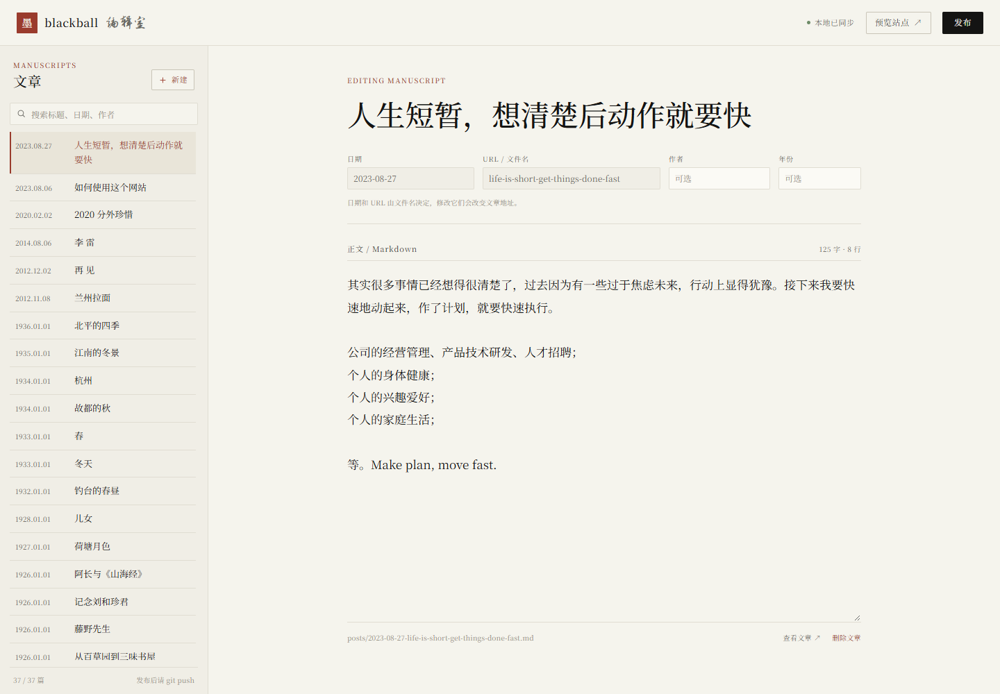

# blackball

一个只放中文文章的个人博客。暖白纸、墨色正文、毛笔标题，单栏阅读，没有客户端
JavaScript。

首页是一件很小的事：一枚荷花印记、一句毛笔标语，下面是从上往下的两列目录，左列
日期、右列标题。文章页更像 Kindle：窄栏、宋体正文、足量留白，没有导航栏和侧栏。

## 写一篇新文章

最方便的方式是用写作工具：

```bash
python new_post.py "文章的标题"
```

它会创建 `posts/YYYY-MM-DD-slug.md`，写入 `## 标题`，然后用 `$EDITOR`、VS Code
或记事本打开。需要作者和年份时：

```bash
python new_post.py "背影" --author 朱自清 --year 1925
```

工具会拒绝覆盖同名文件。常用参数：

```text
--slug SLUG     指定文件名（默认从标题生成）
--date DATE     指定日期 YYYY-MM-DD（默认今天）
--no-open       不打开编辑器
--no-build      编辑完不重新构建
--serve         编辑完直接启动本地预览
--port PORT     预览端口（默认 8000）
```

也可以手动创建 `posts/YYYY-MM-DD-slug.md`，第一行写 `## 标题`。作者元信息是可选的：

```markdown
---
author: 朱自清
year: 1925
---

## 背影

正文……
```

## 网页版编辑室

除了 `new_post.py`，仓库还带一个本地网页编辑器：



```bash
python -m pip install -r Editor/requirements.txt
python Editor/server.py
```

Windows 下可以直接双击 `Editor/start.cmd`。打开 <http://127.0.0.1:8787/>。
左侧选择或新建文章，右侧编辑，点「发布」会：

1. 写入或更新 `posts/*.md`；
2. 调用现有的 `build.py`；
3. 更新 `index.html`、`html/*.html` 和 `404.html`。

它不会执行 git 命令。你只需要在发布后自行 `git add / commit / push`。

编辑器只绑定 `127.0.0.1`，不会进入 GitHub Pages 发布产物。完整说明见
[Editor/README.md](Editor/README.md)。

## 本地预览

需要 Python 3.9+：

```bash
python -m pip install -r requirements.txt
python build.py --serve
```

打开 <http://127.0.0.1:8000/>。只构建、不启动服务器：

```bash
python build.py
```

`build.py` 会重写 `index.html`、`html/*.html` 和 `404.html`，只删除带生成标记的
旧页面，不碰文章和模板。

## 发布

工作流使用 GitHub 官方 Pages actions，仓库需要一次性设置：

**Settings → Pages → Build and deployment → Source: GitHub Actions**

之后推送到 `gh-pages`、`main` 或 `master` 都会自动构建和发布。也可以在 Actions
页面手动运行。若仍希望从分支直接发布，本地运行 `python build.py` 后提交生成的 HTML
即可。

## 站点配置

编辑 `site.json` 可以改站点标题、标语、简介、作者和页脚箴言。页脚现在只显示
「求道之人，不问寒暑。」。

视觉参数集中在 `assets/css/style.css` 顶部：纸张、墨色、朱砂色、正文宽度。标题字体
是 **Zhi Mang Xing（志莽行书）**，正文是 **Noto Serif SC**；两者都有本地字体回退。

## 30 篇公版散文

站内现有的 30 篇现代散文用于真实内容下的版式测试，保留了你原有的 7 篇文章，共 37 篇：

- 鲁迅 8 篇
- 朱自清 8 篇
- 郁达夫 7 篇
- 周作人 7 篇

这些都是公版作品，文本从公版电子文集整理，清除了网页水印、页眉、编者按和明显的
OCR 错字。它们不是学术校勘本；若要正式引用，请以权威版本核对。

## 目录

```text
build.py                生成器
new_post.py             新文章创建与预览工具
Editor/                 本地网页编辑器（Flask + React）
site.json               站点配置
posts/                  Markdown 原文
templates/              base、首页、文章、404 模板
assets/css/style.css    纸张版式与字体
html/                   生成的文章页
index.html              生成的首页
404.html                生成的 404
docs/plans/             设计记录
```

## 说明

- 旧文章 URL 全部保留，包括 `02023-08-06-about.html`。
- 站点构建只依赖 `Markdown`；网页编辑器额外依赖 `Flask`。
- 文章页面没有主题切换、目录、进度条、复制按钮或其他前端脚本。
- 字体从 Google Fonts 加载，失败时回退到宋体/楷体，页面仍可读。
- `update.py` 已被 `build.py` 取代。
