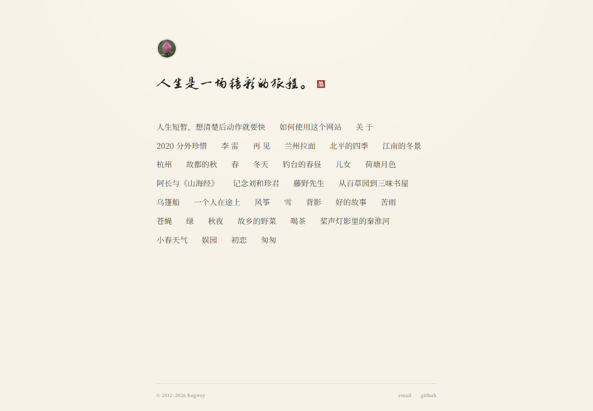
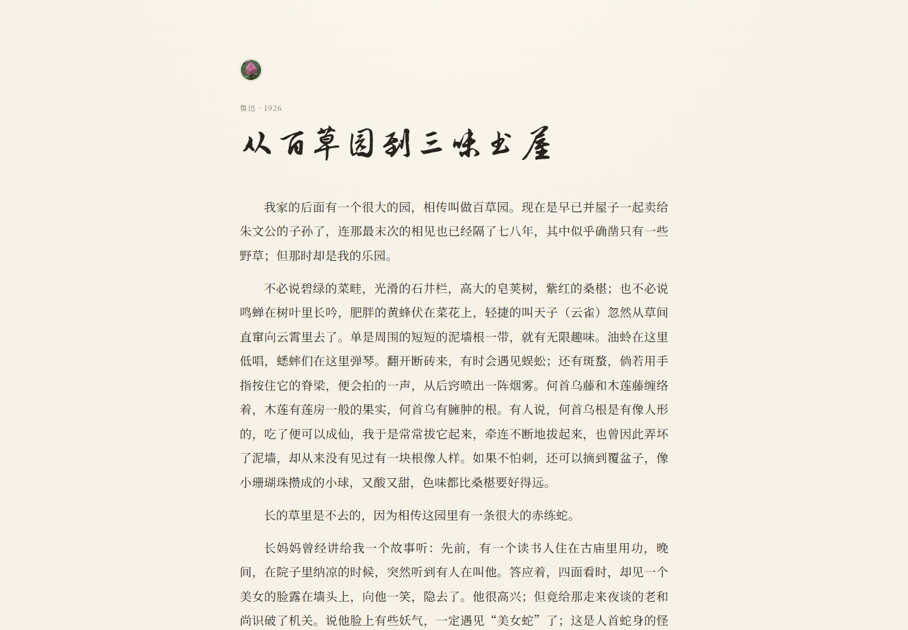

# blackball blog — paper reading edition

> Status: approved 2026-10-20
> Direction: **warm paper, Kindle-like Chinese reading, brush titles**

## Preview





## Context

`blackball` is a Chinese-only personal blog. The owner likes the old extreme-simple
character of the site: a lotus mark, one sentence, and post titles flowing like a tag
cloud. At the same time, the reading pages should be as quiet and comfortable as a Kindle,
and a tool should make adding new writing effortless.

## Goals

1. Make writing a new post one command, including opening the editor and optionally
   previewing the result.
2. Make long Chinese articles comfortable on phone and desktop: one narrow column,
   generous margins, no interface chrome, no client-side JavaScript.
3. Use a brush display face close in spirit to Wang Xizhi, paired with a dependable
   long-form body face.
4. Fill the blog with 30 complete public-domain modern Chinese essays to test the real
   reading experience, while keeping the owner's seven posts.

## Non-goals

- Dark mode, theme switching, TOC, progress bars, copy buttons, or scroll animations.
- Tags, search, comments, analytics, or RSS.
- A JavaScript framework or a general-purpose SSG.

## Authoring tool

`new_post.py` creates a dated Markdown file, writes the title line, and opens the editor.
It supports optional author/year metadata, a custom slug or date, a no-open mode, an
automatic build, and an optional local preview. It refuses to overwrite an existing file
and never commits or pushes automatically.

```bash
python new_post.py "文章的标题"
python new_post.py "背影" --author 朱自清 --year 1925
python new_post.py "文章的标题" --serve
```

## Content model

- Posts live in `posts/` as `YYYY-MM-DD-slug.md`.
- The first line beginning with `## ` is the title.
- An optional leading front-matter block supplies `author` and `year`:

  ```markdown
  ---
  author: 朱自清
  year: 1925
  ---
  ```

- The filename supplies the date and URL. Existing URLs are preserved.
- The first paragraph supplies the page description.
- The article byline is `author · year` when provided, otherwise the filename date.

## Layout

- **Paper:** warm ivory `#f7f2e7`, ink `#26241f`, muted warm grey, cinnabar accent
  `#a23b2c`.
- **Home:** small lotus mark, brush tagline with a tiny `墨` seal, then all post titles as
  one uniform inline tag cloud. Newest first. No cards, dates, or counts.
- **Article:** small lotus link home, author/year, brush title, prose, one return link.
- **Width:** 680px; 19px body text with 2.0 line-height and 2em first-line indent on
  desktop, 18px on phones. No fixed header or sidebar.
- **Chrome:** no gradients except a barely visible top paper light, no shadows, no motion.
- **Footer:** copyright, email, GitHub, one hairline rule.
- **404:** the same quiet paper page.

## Typography

- **Titles:** **Zhi Mang Xing** (志莽行书), an open-source semi-cursive brush face. Wang
  Xizhi has no complete modern font; this is the closest practical approximation.
- **Body:** **Noto Serif SC**, with Source Han Serif / Songti / SimSun fallbacks.
- **Code:** system monospace only where code appears.
- The two webfonts load from Google Fonts with `display=swap`; local fallbacks preserve
  readability when the request fails.

## Sample essays

Thirty complete public-domain modern Chinese essays are included alongside the original
seven posts (37 total):

- 鲁迅 8
- 朱自清 8
- 郁达夫 7
- 周作人 7

The texts come from public-domain ebook collections. Web watermarks, chapter page breaks,
editorial notes, inline footnotes, and obvious OCR errors were removed or normalized.
They are for layout testing and reading, not scholarly citation; a critical edition should
be consulted for formal quotation.

## Build and publishing

`build.py` validates the site config and filenames, parses optional front matter, renders
Markdown, writes `index.html`, `html/*.html`, and `404.html`, and removes only stale pages
carrying the generator marker. The only dependency is `Markdown`.

`.github/workflows/publish.yml` builds with Python 3.12, stages only public static files,
and deploys through GitHub's official Pages actions. One-time setup: **Settings → Pages →
Build and deployment → Source: GitHub Actions**.

## Verification

- 37 posts, 39 pages, all internal links and preserved URLs.
- 30-essay audit: title, author, year, length, and residue checks.
- Browser checks at 320, 390, 768, 1024, 1440, and 1920px with no horizontal overflow.
- Brush and body webfont checks, long and short brush titles, desktop and mobile reading.
- `new_post.py` creation, front matter, editor handoff, overwrite protection, and preview.
- Build failure and stale-page cleanup.
